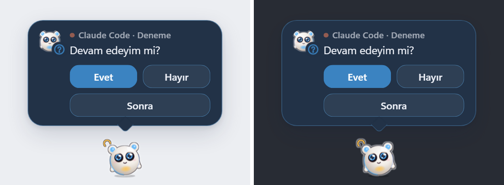
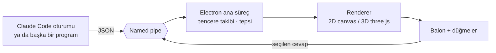

Pamuk, Windows masaüstünde süzülen küçük bir karakter. Boştayken pencere kenarlarının arkasına saklanır, kulakları görünür; bir ajan bir şey sorduğunda ya da iş bittiğinde imlecin yanına gelip balonla haber verir. Tam ekran oyun ya da filmde hiç görünmez.

<p align="center"></p>
<p align="center"></p>

## Özellikler

| | Ne yapar |
|---|---|
| 🎨 **İki gösterim** | 2D sprite ya da gerçek zamanlı 3D (three.js); geçiş tepsi menüsünden |
| 💬 **Balonlar** | Bildirim ve düğmeli soru (en çok 5 seçenek); cevaplanmayan soru köşede bekler |
| 🔌 **Named pipe** | Mesajlar `\\.\pipe\zepul-yoldas` borusundan gelir; ağ portu açılmaz |
| 🕊️ **Uçuş modeli** | Yumuşak süzülme, pencerenin iç köşesine konma, kenar arkasına saklanma |
| 🌙 **Saygılı** | Tam ekranda gizlenir, gece uyur, rahatsız etme ve sessiz kip |
| 🧪 **Testler** | Tam ekran algısı ve boru iletisi için birim testleri |

## Nasıl çalışır



Örnek ileti:

```json
{ "tip": "soru", "metin": "Devam edeyim mi?", "secenekler": ["Evet", "Hayır", "Sonra"] }
```

## Kurulum

```bash
npm i
npm start            # tepsiye ikon gelir, Pamuk ekranda belirir
npm test             # birim testleri
node ornek-gonder.mjs   # deneme iletisi gönderir
```

Kısayol: `Ctrl+Alt+Z` göster/gizle. Ayarlar `%APPDATA%\zepul-yoldas\ayarlar.json` dosyasında.

## Teknoloji

Electron · JavaScript · three.js · Windows named pipe

three.js MIT lisanslıdır (© Three.js Authors).
